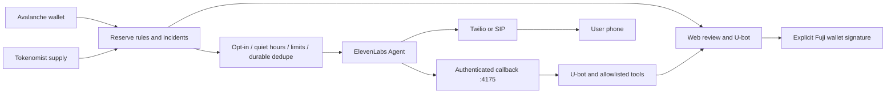

# U-Guardian — wallet risk assistant

A Thai-first financial assistant: Avalanche wallet evidence → personal reserve rules → Tokenomist context → U-bot explanation → ElevenLabs voice → explicit user review. Runs locally or on Vercel with Node.js 24.

## Vercel demo

The hosted app requires no login. Open **Connections** to enter your own U-bot, Avalanche Data, Tokenomist and ElevenLabs credentials. The deployment ships with no provider credentials. Each browser receives a random HttpOnly/Secure/SameSite session cookie; one wallet and its settings belong to that browser session. Other visitors start with an empty configuration.

Session configuration, keys and records are encrypted using AES-256-GCM and persisted in a **private Vercel Blob store**. The encryption key is derived from the store token: rotating that token requires migrating encrypted records or starting new sessions. Provider keys never enter browser storage, API state responses or the repository. Clearing cookies loses access to the previous session; clear API keys in Connections before clearing cookies if you want them removed from that record. This is a hackathon demo, not a multi-user financial service.

- Live monitoring refreshes every 60 seconds **while the page is visible**. Background automatic calls are available only in the local server runtime.
- Manual phone calls and authenticated `/phone/tool` callbacks are supported when the user supplies working ElevenLabs/telephony configuration. Set the public callback origin to the deployed site's HTTPS origin, then update the Guardian agent. Real delivery still requires a compatible carrier account.
- Conditional Blob writes and a six-minute lease serialize mutations across serverless workers. Persisted call intent prevents an uncertain outbound request from being automatically repeated. An interrupted request can temporarily block writes until its lease expires.
- Audio uploads are limited to 4 MB on the cloud route. Voice is push-to-talk STT and TTS; continuous WebRTC conversation is not implemented.

To deploy your own copy: import this repository in Vercel, use its root directory, create/connect a **private Blob store** with `BLOB_READ_WRITE_TOKEN`, and deploy. `vercel.json` configures static assets and a Node function. Do not add your local provider `.env` to the deployment; enter keys through the app instead. GitHub/Vercel deployment access is separate from the app's anonymous browser session.

## Run

```powershell
cd C:\githubProject\u-hackathon\guardian-poc
npm ci
npm start
```

Open http://127.0.0.1:4173. The dashboard binds only to loopback. A separate authenticated phone-tool listener binds to 127.0.0.1:4175. This remains a single-user local MVP, not a publicly deployed multi-user service.

## Configuration and persistence

- Provider keys and voice/model/agent-mode configuration are in **`.env`**. Connections saves changes there atomically; blank key inputs preserve the saved key. Credentials are never returned in `/api/state`, printed in logs, or saved to browser storage. The supplied `env.txt` was migrated and removed after verifying all four keys.
- Wallet settings, identity mappings, snapshots, phone settings, managed Agent ID, incidents, transfer state and call attempts persist in **`.local/state.json`**. The phone callback secret is in **`.local/phone-secret`**. Both locations are ignored by Git. Phone sessions and recipient details are local private state, not public API response fields except the recipient's own settings.
- Restarting preserves configuration and unresolved transactions/call attempts. A submitting call restored after interruption is `unknown`, never retried automatically.
- `.env.example` contains names only. Copy it only when setting up a new installation. Use Connections to rotate individual keys. **ล้าง credentials** clears all four provider keys from memory and `.env`.
- Optional Twilio carrier credentials (`TWILIO_ACCOUNT_SID`, `TWILIO_AUTH_TOKEN`, `TWILIO_FROM_NUMBER`) also live in `.env`; Connections preserves them. Run `npm run phone:connect` with the app running to verify an owned Voice number, import/reuse it in ElevenLabs, and select it locally. This never places a call or enables automatic calls. Rotate carrier credentials in both `.env` and an existing ElevenLabs phone import.

## Use the complete flow

1. Open Connections and test Avalanche, Tokenomist and U-bot. Load ElevenLabs voices and choose a voice.
2. Click **ตั้งค่า wallet จริง**. Enter a public address, network, reserve asset, token-unit target, purpose and due date. Watching an address does not prove ownership.
3. Read the source panel: network, RPC block/time, indexer status and coverage warnings. Mainnet is read-only; Fuji supports test AVAX actions.
4. Review **What matters to your goal** and **On your horizon**. Native AVAX maps to Tokenomist `avalanche-2` on Mainnet. Other assets require an explicit chain + contract identity match. Matching symbols is never sufficient. Fuji does not inherit Mainnet supply events.
5. Ask Guardian to assess the reserve, explain unlocks, or simulate a top-up. Numeric summaries come from deterministic tools. The U-bot explanation is separate. Tool plans are allowlisted, validated, and get at most one format retry. Invalid plans execute nothing.
6. Use the microphone to transcribe Thai, review the text, then send. **ฟังคำตอบ** uses ElevenLabs TTS; browser speech fallback is explicitly labeled. This web flow is STT → tools → TTS, not continuous realtime audio.
7. Enable wallet monitoring to refresh every 60 seconds while the server runs in Live mode. The page polls state every 15 seconds while visible. A reserve shortfall creates a deduplicated incident. Supply events are contextual watch signals, not predictions of a price drop.
8. Configure **Phone alerts** if real calls are needed. See [PHONE-SETUP.md](PHONE-SETUP.md). A test call requires a separate review and confirmation. No phone number has been imported into ElevenLabs yet; therefore no real call has been placed.

## Provider responsibilities

| Provider | Used for | Limits and provenance |
|---|---|---|
| Avalanche public RPC | Native AVAX and selected ERC-20 reserve at one block; Fuji gas/nonce checks and receipts | Exact integer token math; goals are token units, not stable fiat purchasing power |
| Avalanche Data API | Token discovery, indexed USD estimates, native/ERC-20 transfers | Up to 3 × 100 tokens and 20 transfers per type; capped/partial data is shown; unknown price is not zero |
| Tokenomist v5 | Catalog, cliff unlocks and daily emission for held mapped assets | Catalog cached 1 hour, data 5 minutes; up to 5 identities and 3 × 100 rows per dataset; future-data access depends on key scope |
| U-bot `/api/chat` | Tool selection and Thai evidence explanation | Web-client API contract; Bearer can expire; no assumed native tool-calling capability |
| ElevenLabs | STT/TTS, Thai phone agent, outbound Twilio/SIP requests, conversation status | Requires a connected outbound number for real calls; API success means submitted, not answered |

Tokenomist event precision, allocation, source and update time are retained. Daily emission includes cliff amounts; the UI does not add those datasets together. Partial coverage or stale evidence is never presented as “safe.” Concentration only triggers a whole-wallet watch rule when all discovered positive-balance assets have indexed prices and the token list is complete. Otherwise the priced subset is labeled explicitly.

## Fuji action

Watch a Fuji destination address, connect a different source wallet in an extension-enabled browser, enter test AVAX and review full addresses/amount/gas. The user explicitly opens the wallet and signs. The backend checks EOA destination, available test AVAX and estimated gas. Drafts expire after five minutes and bind the source's pending nonce at authorization.

Receipt verification checks chain, source, destination, value, empty calldata and nonce. Pending/uncertain sends block another draft. A user-rejected signature cancels the attempt. If a wallet returns an uncertain result, inspect its history and provide the transaction hash. No agent or phone tool can execute transfers, change phone settings or sign transactions. Voice preparation creates a web review proposal only.

## Phone architecture



Phone calls default off. Automatic calls require Live mode, monitoring enabled, a fresh successful reserve snapshot, an open reserve incident, recipient consent and complete telephony settings. Default quiet hours are 22:00–08:00 Asia/Bangkok; defaults allow at most two attempts/day with 60 minutes between calls. Manual tests bypass quiet hours only. A call intent is saved before the external request; timeouts/ambiguous failures are not silently retried. Supply-only watch signals do not automatically call.

The phone agent can explain the supplied snapshot without a public callback. With an HTTPS callback configured, a webhook tool forwards spoken questions to U-bot and live tools. Each request requires a server secret and a short-lived per-call session bound to the wallet settings. Only `/phone/tool` exists on the separate listener. Never tunnel the dashboard port. The callback cannot send funds, place another call, read credentials or change settings.

## Source layout

- `application.mjs`: shared application routes, provider configuration and monitoring
- `server.mjs`: local server and callback listeners
- `api/index.mjs`, `cloud-store.mjs`: Vercel adapter, private encrypted sessions and conditional-write leases
- `avalanche.mjs`: chain reads, exact token math, Fuji draft/receipt verification
- `tokenomist.mjs`: v5 API, cache, paging, identity coverage and supply normalization
- `live-wallet.mjs`, `risk.mjs`: live rules, incidents, personal context and tool results
- `planner.mjs`, `providers.mjs`: U-bot planning/stream parser, ElevenLabs audio
- `phone.mjs`: agent provisioning, outbound call policy, durable call intent and session authentication
- `storage.mjs`: atomic `.env` and local-state persistence
- `public/`: existing visual system, live data, risk, mapping and phone setup UI

## Verification

```powershell
npm test
```

Unit tests cover original demo behavior, token precision, partial failures, identity spoofing, supply aggregation, stale evidence, persistence, phone opt-in/quiet hours/caps, unknown-call dedupe, callback authorization and Fuji transaction identity.

Verified on 2026-10-15:

- Real Avalanche RPC + Data API reads succeeded for a public example wallet (`indexerStatus: ok`).
- Tokenomist v5 catalog, cliff and daily-emission reads succeeded. Coverage is partial because unrelated ERC-20 contracts were intentionally left unmapped.
- Updated U-bot token completed live assessment and supply-event tool flows; format validation/retry was added for occasional prose replies.
- Real ElevenLabs Thai TTS produced 98,263 bytes and STT successfully transcribed that generated audio.
- A Thai `eleven_v3_conversational` phone agent was created. `eleven_flash_v2_5` was rejected for Thai by the provider and is not used for the phone agent.
- Desktop/mobile integration checks passed without JavaScript errors or horizontal overflow. An unauthenticated callback returned 403.
- Phone transport/policy and wallet signing are fixture-tested. **Zero real telephone calls or funded Fuji transactions were sent.** Real phone delivery still needs a Twilio/SIP caller number; live tool access during a call also needs a reachable HTTPS callback.

Optional browser tests use Playwright with Edge; set `PLAYWRIGHT_MODULE` and `BASE_URL`. `system-browser-smoke.cjs` is an opt-in live API test and uses a public example wallet. Isolate test environment/state with `GUARDIAN_ENV_FILE`, `GUARDIAN_STATE_DIR`, `PORT` and `PHONE_PORT`. Never run fixture configuration tests against the user's primary `.env`.

## Official references

- [Tokenomist v5 unlock events](https://docs.tokenomist.ai/api-documents/unlock-events/v5)
- [Tokenomist v5 daily emission](https://docs.tokenomist.ai/api-documents/daily-emission/v5)
- [ElevenLabs Twilio native integration](https://elevenlabs.io/docs/eleven-agents/phone-numbers/twilio-integration/native-integration/)
- [ElevenLabs outbound API](https://elevenlabs.io/docs/api-reference/integrations/twilio/outbound-call)
