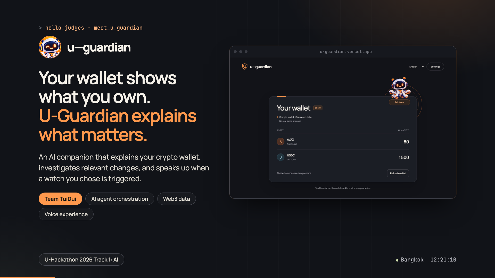
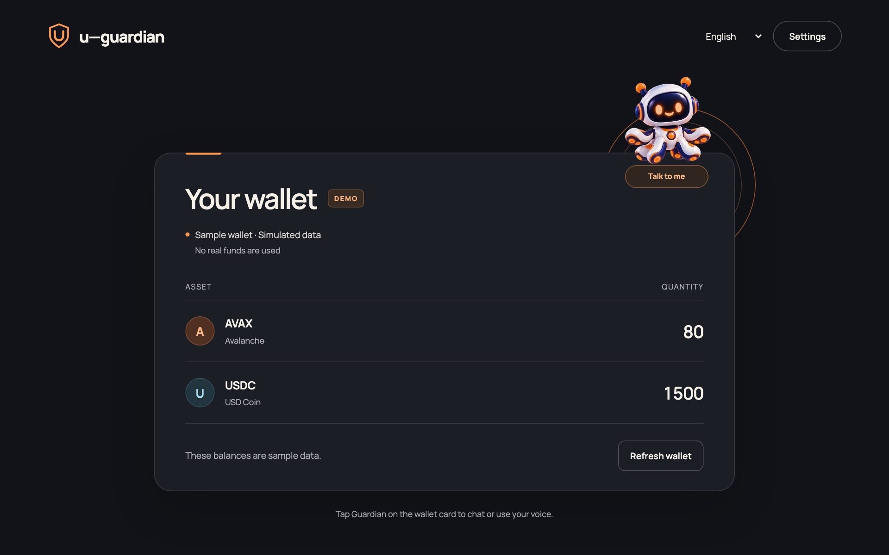
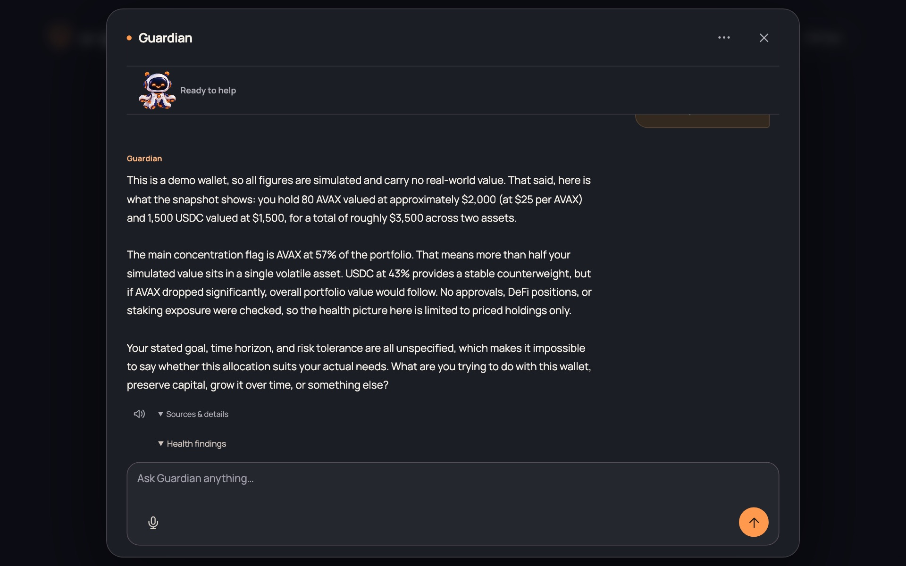
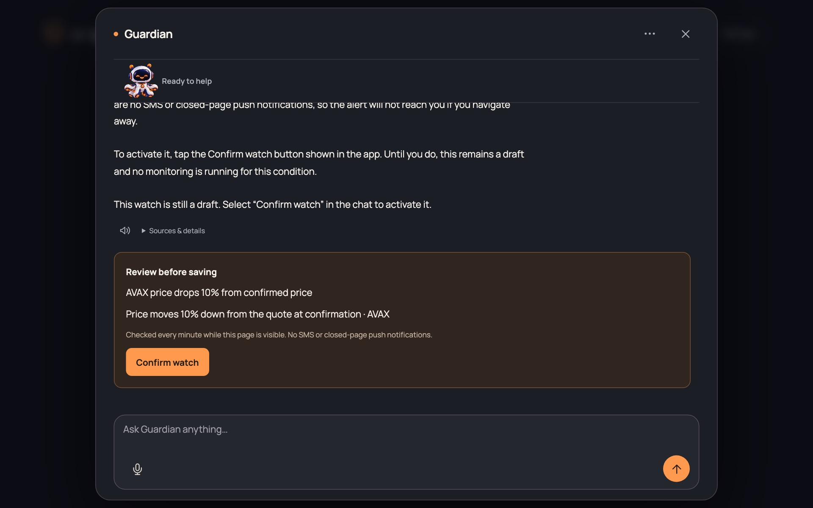
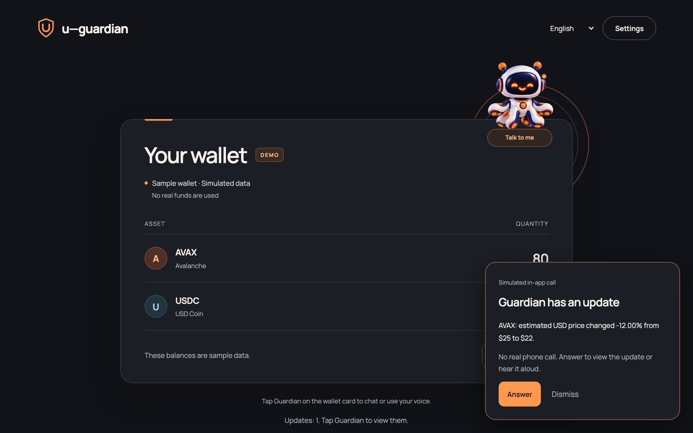
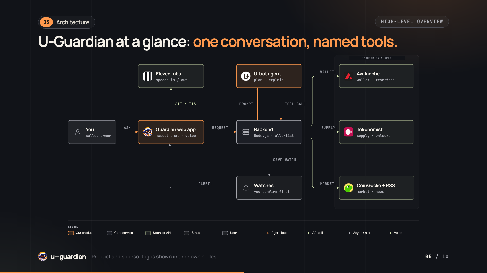

<div align="center">


# U-Guardian

**Your wallet shows what you own. U-Guardian explains what matters.**

An AI companion that explains your crypto wallet, investigates what changed, and speaks up when a watch you chose is triggered.

[](https://u-guardian.vercel.app)
[](https://u-guardian-pitch-desk.nonnnz.dev)
[](deck/U-Guardian-Pitch-Deck.pdf)


</div>

<p align="center">
  <a href="https://u-guardian.vercel.app"></a>
</p>

## Try it

| | |
|---|---|
| **Demo** | https://u-guardian.vercel.app (click the mascot, then **Connect U-Bot** in Settings) |
| **Pitch deck** | https://u-guardian-pitch-desk.nonnnz.dev (13-page [PDF](deck/U-Guardian-Pitch-Deck.pdf)) |
| **Repo** | this one. Hackathon MVP; "next" items in the deck are proposals, not shipped behavior |

Try asking: **"Check my wallet health."** · **"Alert me when AVAX price drops 10% from the price when I confirm."** · **"What changed since my last briefing?"** Then open **Settings → Simulate AVAX price −12%** to see a simulated in-app alert (demo data, no real call).

## Screenshots

<table>
  <tr>
    <td width="50%"><br><sub>One page: the wallet, with the mascot as the agent interface.</sub></td>
    <td width="50%"><br><sub>Wallet health in plain language, with Sources &amp; details.</sub></td>
  </tr>
  <tr>
    <td width="50%"><br><sub>Every watch is reviewed and confirmed before it is active.</sub></td>
    <td width="50%"><br><sub>A triggered watch arrives as a simulated in-app call (demo data).</sub></td>
  </tr>
</table>

## How it works

<p align="center"></p>

Three jobs in one conversation:

1. **Wallet health**: reads a public Avalanche wallet and explains holdings, coverage and concentration against a saved goal.
2. **What changed and monitor**: compares the latest observations with the last briefing and drafts a specific watch for you to confirm.
3. **Advice with real information**: explains trade-offs and uncertainty from retrieved project, market, tokenomics and headline evidence.

U-bot chooses a tool, the Node.js backend validates it against an allowlist, and the result goes back to U-bot to explain. The model never runs generated code. Sources: Avalanche (wallet/transfers), Tokenomist (supply/tokens), CoinGecko plus publisher RSS (market/news), ElevenLabs (speech in and out).

## Team TuiDui

| | |
|---|---|
| **Wayu Tharai**, AI Engineer, Bangkok Bank | [GitHub](https://github.com/Wayu650610806) · [LinkedIn](https://www.linkedin.com/in/wayu-tharai-b575a5338/) |
| **Ratchanon Buachum**, AI Engineer, Armstrong Technology | [GitHub](https://github.com/nonnnz) · [LinkedIn](https://www.linkedin.com/in/ratchanon-buachum/) |

---

# Developer guide

## What works

- Wallet health: Avalanche C-Chain balances, available recent transfers, concentration when priced coverage is complete, and goal-aware explanations.
- Research: U-bot chooses tools in a bounded multi-step loop. Tokenomist supplies token identity, allocation, fundraising, buyback, burn and mapped wallet supply evidence when available.
- Changes: compare quantities, observed USD unit quotes and available transfers with the last acknowledged briefing; check again on reopening. This is not price P&L or a complete transaction investigation.
- Tracking: explicitly confirmed wallet-change, supply-event, review-date, activation-price percentage and transfer-USD threshold rules. New alerts can appear as simulated in-app calls; Answer opens chat and can read them aloud.
- Market and advice: CoinGecko project descriptions, market metrics and search trends, plus attributed CoinDesk/Cointelegraph RSS headline matches. These are bounded sources, not forecasts or exhaustive news.
- Voice: push-to-talk through ElevenLabs transcription, with optional spoken replies. Typing remains available.

## Set up from the main page

Open **ตั้งค่า**. Settings stay in a dialog on the same page.

1. Configure `UBOT_SUPABASE_ANON_KEY`, `UBOT_EMAIL`, and `UBOT_PASSWORD` as server-only values in `.env` locally or Secret environment variables on Vercel. The URL and chat endpoint have defaults in `.env.example`.
2. Under **Connections**, click **Connect U-Bot**. It verifies the shared demo account with a real U-Bot response, then enables U-Bot in Guardian chat. **Disconnect U-Bot** clears only this visitor's connection and conversation state.
3. Configure Avalanche, Tokenomist, and ElevenLabs separately if needed. The demo wallet and those integrations remain independent of U-Bot authentication.
4. Under **Wallet**, choose Live, enter a public Avalanche C-Chain address, and save. No private key or signature is needed.
5. Optionally save goals and verify Tokenomist asset matches. Close Settings and open Guardian chat.

Demo wallet data and local example answers are synthetic unless U-bot mode is selected for reasoning. Public market/news tools still return real sourced evidence. Settings provides synthetic price-drop and outgoing-transfer buttons. See [USER-TEST-GUIDE.md](USER-TEST-GUIDE.md) for the current three-pillar capability matrix, English prompts, limits and repeatable demo.

**Connect U-Bot uses a shared backend demo account.** Visitors never enter a Bearer token or receive the account password or access token. The server signs in with Supabase, verifies a genuine chat response, and signs in again for each chat request. An expired access token triggers one fresh login and retry. This does not connect a visitor's personal U-Bot account. See [UBOT_INTEGRATION.md](UBOT_INTEGRATION.md).

Planning and explanation use separate prompts. The planner returns validated JSON and allowlisted arguments. A `finishAfterTool` hint skips a redundant planning request when one tool is sufficient; token search still requires a separate research step. The explainer may use numbers, units, dates and token names supported by this turn's evidence. Large evidence is compacted into valid JSON with explicit omissions, while full tool results remain in the UI subject to Debug display limits.

The agent allows at most five planning steps, one retry per invalid plan, a 40-second planning-call timeout, a 55-second explanation timeout, and a shared 170-second provider budget with time reserved for the answer. Avalanche/Tokenomist requests inherit the remaining budget. Existing evidence is preserved and a visible warning is returned if later planning or explanation fails. A provider failure before any evidence remains an error. Backend persistence/response overhead is outside the provider budget.

Watch drafts require explicit user intent and matching supported scope. Unsupported portfolio-value, rolling-price, selected-transfer-filter and notification-channel requests return a capability explanation without creating a draft. Unknown tool arguments, impossible dates and common selected-token/threshold substitutions are rejected. This combines schema checks, conservative intent checks and prompting; it is not a guarantee of semantic accuracy for every possible wording. Confirmation is still required to activate a watch.

## Boundaries

The public Vercel app checks active watch rules every minute while the page is visible. Closing chat does not stop those checks; closing the page does. There is no provisioned background scheduler, SMS or Web Push. Voice is not continuous listening. The app does not trade, audit approvals, analyze DeFi positions, verify scam safety or predict buy/sell timing.

The old dashboard and separate Settings page have been removed. Old /settings.html and /embed-example.html links redirect home. Embedding examples, transport API and embedding documentation are removed from the current scope. The custom element is an internal UI module, not a released integration SDK. Legacy phone/Fuji/backend routes remain for compatibility, but their old screens are no longer part of the app.

## Debug the agent

Open the mascot chat and enable **Debug** in its header. The adjacent **Chat / Debug** (or **แชต / Debug** in Thai) tabs switch between the conversation and diagnostics. Send a message, request a briefing or use voice in the chat tab, then inspect each expandable event in Debug.

Each request records timestamps and duration, the input, U-Bot prompts, non-secret provider metadata, validated JSON decision, tool arguments/results, retries, errors, session saves and final answer. Local demo rules and briefings are explicitly identified as not calling U-bot. Voice requests record STT text and TTS metadata, not audio bytes in the log.

Logs arrive **after each request completes**, not as a live stream. Debug retains the latest four requests in browser memory only; clearing logs, disabling Debug or reloading removes them. Logs are not written to chat history, Blob records or server console. Credentials are redacted before delivery, but messages and public wallet data remain visible. Long payloads are explicitly truncated (40,000 characters per event; bounded request total/event count). These are operational request/response logs, not the model's private reasoning. Network/platform failures before the application responds may have no backend trace.

## Run locally

Requires Node.js 24.

```powershell
npm ci
npm start
```

Open http://127.0.0.1:4173. Settings writes local provider credentials to .env; saved wallet/agent state stays in .local. Both are ignored by Git. See .env.example for environment names. Never commit credentials.

## Deployment and storage

Vercel serves public assets and a Node function. Connect a **private Vercel Blob store** using BLOB_READ_WRITE_TOKEN. Provider credentials are supplied through Settings, not bundled into the deployment.

The hosted demo has no login. A random HttpOnly/Secure/SameSite session cookie identifies one wallet and settings for each browser session. Records and credentials are encrypted with AES-256-GCM in private Blob storage; provider keys are not returned in state responses or kept in browser storage. Clearing cookies loses access to that session. The encryption key is derived from the Blob token, so rotating that token requires data migration or new sessions. This is a hackathon demo, not a multi-user financial service.

Conditional writes and a lease serialize serverless mutations; an interrupted request may temporarily block another operation. Audio uploads are capped at 4 MB. GitHub/Vercel access is separate from an app visitor's session.

## Pitch deck site (source and deploy)

The deck is a self-contained page generated from `deck-src/template.html` (fonts, logo, screenshots, mascot poster, QR code and a live API pull are inlined, so nothing depends on outside hosting).

```bash
node deck-src/build.mjs          # writes deck/index.html
cd deck-src && npx wrangler deploy   # Cloudflare Worker serving ./deck as static assets
```

- Content follows [pitch deck.md](pitch%20deck.md). Slide 4 is a clickable walkthrough of the real product; printing or exporting to PDF expands it into four static pages. Keys: arrows/space, `N` speaker notes, `F` fullscreen.
- The architecture slide comes from `deck-src/diagrams/` (`python3 deck-src/diagrams/build_architecture.py`, made with the diagram-design skill).
- Worker config: `deck-src/wrangler.jsonc`.

## Verification

```powershell
npm test
npm run build
node test/guardian-browser-smoke.cjs
node test/guardian-voice-smoke.cjs
node test/debug-browser.cjs
```

Browser tests use Playwright with Edge; set PLAYWRIGHT_MODULE to its installed module location when needed. Run an isolated server at port 4180 (or set BASE_URL), with GUARDIAN_IGNORE_SUPPLIED_KEYS=1, a separate GUARDIAN_ENV_FILE and GUARDIAN_STATE_DIR. The settings test writes a dummy credential to that isolated environment file. Never run it against a server using your actual credentials.

The browser smoke test covers collapsed chat, focus/Escape, reports, watch confirmation, settings persistence, mobile layout, and controlled wallet/mapping fixtures. The voice smoke uses a synthetic microphone and mocked speech APIs; it does not test a physical microphone or incur provider charges.


## English and Thai

English is the default interface. Use **English / ไทย** in the header to switch; the preference is saved locally under `guardian-language`. Switching reloads the page and clears its temporary chat/Debug display, but keeps saved wallet/provider settings, goals and watches. It is blocked while a task is running.

The browser sends `x-guardian-language: en|th` on every API request, including audio uploads. HTTP requests default to English. Request-scoped async context keeps concurrent callers’ languages separate. Planner replies, watch labels, evidence explanations, local briefings, capability guards and provider errors use the selected language. STT receives `eng` or `tha` as its language hint ([ElevenLabs API](https://elevenlabs.io/docs/api-reference/speech-to-text/convert)); TTS reads the resulting text with the configured voice. User text, token identities, raw evidence and saved goal option values are not machine-translated.

Authored strings live in `public/messages.js`; marked HTML uses `public/i18n.js`, and server copy uses `locale.mjs`. The Thai source keys retain compatibility with existing saved goal values. Direct legacy library calls without a request context retain Thai.

Additional browser verification (isolated test server only):

```powershell
$env:BASE_URL='http://127.0.0.1:4186'
node test/bilingual-browser.cjs
$env:TEST_LANGUAGE='en'
node test/guardian-voice-smoke.cjs
$env:TEST_LANGUAGE='th'
node test/guardian-voice-smoke.cjs
```

See [AGENT-EVALUATION.md](AGENT-EVALUATION.md) for observed live English provider results and test limitations.
